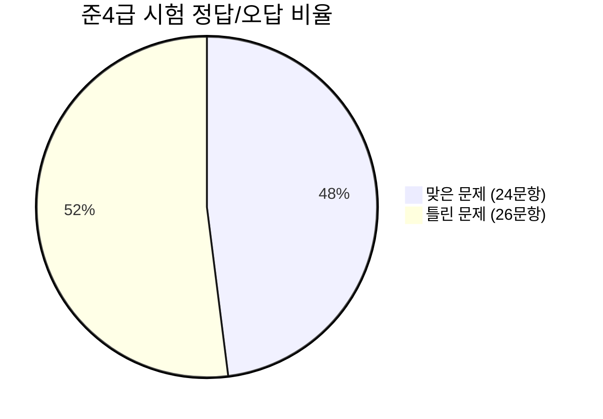

# 📊 대한민국한자급수자격검정 준4급 가형 성적 분석표

## 📌 1. 종합 성적 요약
- **수험자**: **안태주** (수험번호: `4-6459-0001`)
- **시험명**: 제111회 대한민국한자급수자격검정시험문제 준4급 가형
- **주관**: 사단법인 대한민국한자교육연구회 / 대한검정회
- **총점**: **48.0점** (24 / 50 문항)
- **결과 판정**: 기초 단자 독해력은 최상위권이나, 복합 어휘 및 한자 쓰기 보완이 필요한 상태

---

## 📈 2. 영역별 성취도 분석

| 문항 영역 | 문항 번호 | 총 문항 | 맞은 개수 | 틀린 개수 | 정답률 | 수준 평가 |
| :--- | :--- | :---: | :---: | :---: | :---: | :--- |
| **한자의 훈음** | 1 ~ 8 | 8 | 7 | 1 | **87.5%** | ⭐⭐⭐⭐⭐ (최우수) |
| **훈음에 맞는 한자** | 9 ~ 15 | 7 | 6 | 1 | **85.7%** | ⭐⭐⭐⭐⭐ (최우수) |
| **독음/사전/유의/반의** | 16 ~ 22 | 7 | 4 | 3 | **57.1%** | ⭐⭐⭐ (보통) |
| **어휘의 독음** | 23 ~ 31 | 9 | 3 | 6 | **33.3%** | ⭐⭐ (보완 필요) |
| **어휘의 뜻** | 32 ~ 34 | 3 | 0 | 3 | **0.0%** | ⭐ (취약) |
| **낱말 한자 표기** | 35 ~ 37 | 3 | 0 | 3 | **0.0%** | ⭐ (취약) |
| **문맥 속 어휘 독음** | 38 ~ 41 | 4 | 2 | 2 | **50.0%** | ⭐⭐⭐ (보통) |
| **한자 쓰기/어휘/이해** | 42 ~ 50 | 9 | 2 | 7 | **22.2%** | ⭐⭐ (보완 필요) |

---

## 💡 3. 학생 총평 및 맞춤형 학습 가이드

1. **뛰어난 기본기 (단일 한자 훈음/독음)**:
   - 1번~15번(단일 한자의 훈음과 한자 고르기)에서 15문제 중 **13문제(86.7%)를 맞힐 정도로 개별 한자 암기력과 기본기가 매우 훌륭합니다.**
2. **주요 보완점 (2글자 복합 한자어 & 모양 유사자 구별)**:
   - 글자가 2개 이상 결합된 한자어(단어)로 넘어가면서 독음 실수(韓藥, 良藥, 要因, 合格 등)와 뜻 오인이 크게 늘어났습니다.
   - 孝(효) ↔ 攷(고), 士(사) ↔ 土(토), 材(재) ↔ 才(재), 半(반) ↔ 班(반)처럼 **한 획 차이로 달라지는 유사 한자를 짝지어 학습**하는 것이 합격의 지름길입니다.
3. **다음 단계 추천**:
   - 본 프로젝트의 `test_results.json` 데이터를 기반으로 학생 맞춤형 **"틀린 한자 단어 플래시카드/퀴즈 웹앱"**을 제작하여 반복 학습하면 단기간 내에 80점 이상으로 성적을 끌어올릴 수 있습니다.

---

## 📋 4. 전체 50문항 O/X 일람표

| 번호 | 영역/유형 | 문제 내용 | 학생 답 | 정답 | 채점 | 번호 | 영역/유형 | 문제 내용 | 학생 답 | 정답 | 채점 |
| :---: | :--- | :--- | :---: | :---: | :---: | :---: | :--- | :--- | :---: | :---: | :---: |
| **1** | 한자의 훈음 | 信 | 3 | 3 | ⭕ | **26** | 어휘의 독음 | 題目 | 4 | 1 | ❌ |
| **2** | 한자의 훈음 | 省 | 3 | 3 | ⭕ | **27** | 어휘의 독음 | 功勞 | 1 | 4 | ❌ |
| **3** | 한자의 훈음 | 責 | 2 | 2 | ⭕ | **28** | 어휘의 독음 | 軍士 | 4 | 2 | ❌ |
| **4** | 한자의 훈음 | 展 | 1 | 1 | ⭕ | **29** | 어휘의 독음 | 良藥 | 1 | 3 | ❌ |
| **5** | 한자의 훈음 | 攷 | 1 | 2 | ❌ | **30** | 어휘의 독음 | 奉命 | 1 | 1 | ⭕ |
| **6** | 한자의 훈음 | 作 | 1 | 1 | ⭕ | **31** | 어휘의 독음 | 術數 | 4 | 4 | ⭕ |
| **7** | 한자의 훈음 | 體 | 4 | 4 | ⭕ | **32** | 어휘의 뜻 | 才氣 | 4 | 3 | ❌ |
| **8** | 한자의 훈음 | 號 | 4 | 4 | ⭕ | **33** | 어휘의 뜻 | 加算 | 2 | 4 | ❌ |
| **9** | 훈음에 맞는 한자 | 일 업 | 1 | 1 | ⭕ | **34** | 어휘의 뜻 | 雲集 | 4 | 1 | ❌ |
| **10** | 훈음에 맞는 한자 | 반드시 필 | 3 | 3 | ⭕ | **35** | 낱말 한자 표기 | 길흉: 운이 좋... | 1 | 3 | ❌ |
| **11** | 훈음에 맞는 한자 | 아이 동 | 1 | 3 | ❌ | **36** | 낱말 한자 표기 | 적중: 목표 따... | 2 | 4 | ❌ |
| **12** | 훈음에 맞는 한자 | 그럴 연 | 2 | 2 | ⭕ | **37** | 낱말 한자 표기 | 재능: 재주와 ... | 3 | 2 | ❌ |
| **13** | 훈음에 맞는 한자 | 들 야 | 4 | 4 | ⭕ | **38** | 어휘의 독음 | 전교생이 학교 ... | 2 | 2 | ⭕ |
| **14** | 훈음에 맞는 한자 | 맑을 청 | 1 | 1 | ⭕ | **39** | 어휘의 독음 | 서로 相反된 견... | 4 | 4 | ⭕ |
| **15** | 훈음에 맞는 한자 | 자리 석 | 3 | 3 | ⭕ | **40** | 어휘의 독음 | 사업에 실패한 ... | 2 | 3 | ❌ |
| **16** | 물음에 알맞은 답 | 해돋이에서 해 ... | 4 | 4 | ⭕ | **41** | 어휘의 독음 | 운전면허 시험에... | 4 | 3 | ❌ |
| **17** | 독음 구별 | 밑줄 친 '樂'... | 4 | 3 | ❌ | **42** | 문맥 속 한자 쓰기 | 현재의 주어진 ... | 1 | 1 | ⭕ |
| **18** | 문맥 속 훈음 | "메달도 중요하... | 3 | 3 | ⭕ | **43** | 문맥 속 한자 쓰기 | 화석은 생물의 ... | 2 | 1 | ❌ |
| **19** | 자전(옥편) 찾기 | '秋'을(를) ... | 2 | 3 | ❌ | **44** | 문맥 속 한자 쓰기 | 우리는 속담이나... | 4 | 4 | ⭕ |
| **20** | 유의자 | '實'의 유의자... | 2 | 2 | ⭕ | **45** | 어휘의 짜임 | 어휘의 짜임이 ... | 4 | 3 | ❌ |
| **21** | 반의자 | '白'의 반의자... | 4 | 1 | ❌ | **46** | 유의어 | '平等'의 유의... | 4 | 1 | ❌ |
| **22** | 공통 한자 완성 | "□一, □三者... | 4 | 4 | ⭕ | **47** | 반의어 | '前半'의 반의... | 3 | 2 | ❌ |
| **23** | 어휘의 독음 | 韓藥 | 2 | 1 | ❌ | **48** | 고사성어의 쓰임 | 문장에서 성어의... | 1 | 3 | ❌ |
| **24** | 어휘의 독음 | 勇氣 | 4 | 4 | ⭕ | **49** | 한자 문화/이해 | '孝'에 관한 ... | 2 | 3 | ❌ |
| **25** | 어휘의 독음 | 所有 | 4 | 3 | ❌ | **50** | 세시풍속/한자어 | '上元'과 관계... | 1 | 3 | ❌ |
